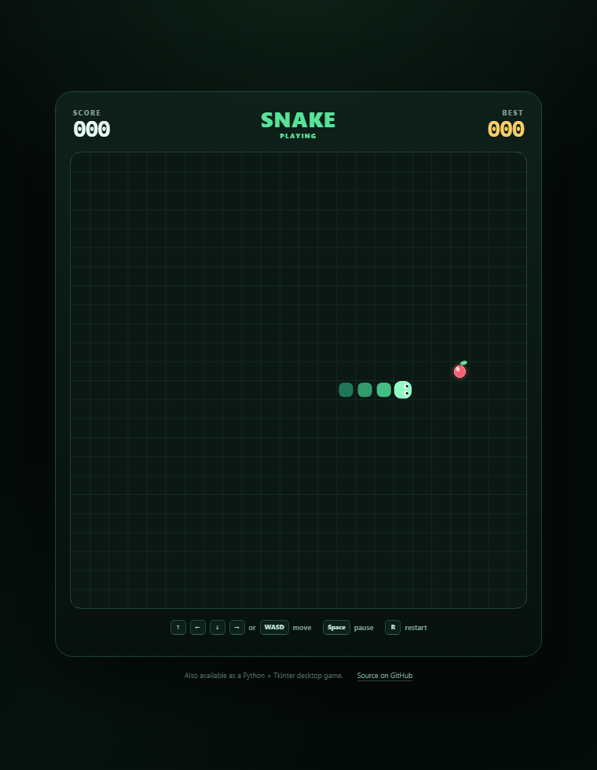
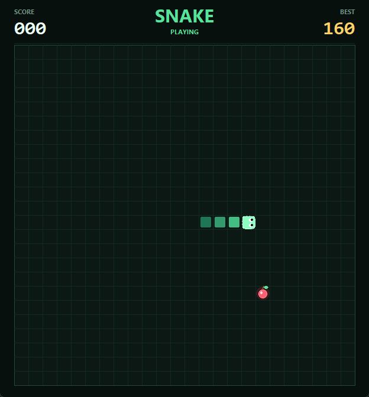

<div align="center">

# 🐍 Snake Game — Python | Play Online & Offline

**A polished, modern take on the classic Snake game — play it instantly in your browser, or run the desktop edition built with pure Python + Tkinter.**

<!-- ══════════════════ CONTACT ME BUTTONS ══════════════════ -->
<p>
  <a href="https://www.fiverr.com/s/p3wN1El" target="_blank">
    
  </a>
  &nbsp;&nbsp;
  <a href="https://www.linkedin.com/in/muhammad-fahad-8b6258370/" target="_blank">
    
  </a>
</p>

<!-- ══════════════════ PLAY GAME BUTTON ══════════════════ -->
<p>
  <a href="https://basharatfahad54-del.github.io/Snake-Game-python-offline-online-play/" target="_blank">
    
  </a>
</p>
<p>
  <a href="#-play-offline-desktop-edition">
    
  </a>
</p>


</div>

---

## 📖 About

**Snake Game Python** is a complete, cross-platform Snake game with **two editions**, so *everyone* can play — **online or offline**:

| Edition | How it runs | Best for |
| --- | --- | --- |
| 🌐 **Browser edition** | Instant play on GitHub Pages — keyboard, swipe, or on-screen touch pad | Anyone, any device, zero setup |
| 🖥️ **Desktop edition** | Pure Python + Tkinter, no third-party packages | Offline play on Windows / macOS / Linux |

Both editions feature the same polished dark theme, a custom-drawn snake and apple, smooth difficulty scaling, and full HUD (score + best score).

<p align="center">
  <a href="https://basharatfahad54-del.github.io/Snake-Game-python-offline-online-play/">
    
  </a>
</p>

## 🎮 Play Online (Everyone, Any Device)

**▶ [Click here to play instantly](https://basharatfahad54-del.github.io/Snake-Game-python-offline-online-play/)** — no installation, no account, nothing.

The browser edition lives in [`docs/index.html`](docs/index.html) and is published with **GitHub Pages**. It supports keyboard, swipe, and on-screen touch controls, and saves your best score locally in your browser.

## 💻 Play Offline (Desktop Edition)

<p align="center">
  
</p>

**Requirements:** Python 3.8+ with Tkinter (already included in the standard Windows and macOS installers).

```bash
git clone https://github.com/basharatfahad54-del/Snake-Game-python-offline-online-play.git
cd Snake-Game-python-offline-online-play
python snake_game.py
```

> 💡 No third-party packages required — runs entirely on Python's standard library.

## 🕹️ Controls

| Input | Action |
| --- | --- |
| Arrow keys / `WASD` | Move |
| Swipe or on-screen pad | Move (browser / mobile) |
| `Space` / `P` | Pause or resume |
| `R` | Restart |
| `Esc` | Quit (desktop) |

## ✨ Features

- 🎯 Classic **24 × 24** grid with wall and self collisions
- 🏆 Score, best score, and an in-game HUD
- ⚡ Speed increases as you eat apples
- 🖥️ Ready, paused, game-over, and win screens
- 📱 Keyboard, swipe, and touch controls in the browser
- 🌙 Dark theme with a custom-drawn snake, apple, and rounded UI
- 📦 **Zero dependencies** — pure Python standard library (desktop) and vanilla HTML/CSS/JS (browser)

## 📂 Project Structure

```text
Snake-Game-python-offline-online-play/
├── snake_game.py          # Python + Tkinter desktop edition
├── docs/
│   └── index.html         # Browser edition (published via GitHub Pages)
├── assets/                # Screenshots
│   ├── snake-game.png
│   └── snake-web-play.png
├── LICENSE                # MIT License
├── README.md              # You are here
└── .gitignore
```

## 🚀 Roadmap

- [x] Browser edition with touch controls
- [x] Desktop edition with Tkinter
- [ ] High-score leaderboard
- [ ] Sound effects and music
- [ ] Multiple difficulty levels

## 🤝 Contributing

Contributions are welcome! Feel free to open an issue or submit a pull request.

1. Fork the repository
2. Create your branch (`git checkout -b feature/amazing-feature`)
3. Commit your changes (`git commit -m 'Add amazing feature'`)
4. Push to the branch (`git push origin feature/amazing-feature`)
5. Open a Pull Request

## 📜 License

This project is licensed under the **MIT License** — see the [LICENSE](LICENSE) file for details.

---

<div align="center">

**⭐ If you enjoyed this game, please give it a star on GitHub!**

<!-- ══════════════════ CONTACT ME (FOOTER) ══════════════════ -->
<p>
  <a href="https://www.fiverr.com/s/p3wN1El" target="_blank">
    
  </a>
  &nbsp;&nbsp;
  <a href="https://www.linkedin.com/in/muhammad-fahad-8b6258370/" target="_blank">
    
  </a>
</p>

**Built with ❤️ by Muhammad Fahad**

</div>
